# Beetle Life Lab

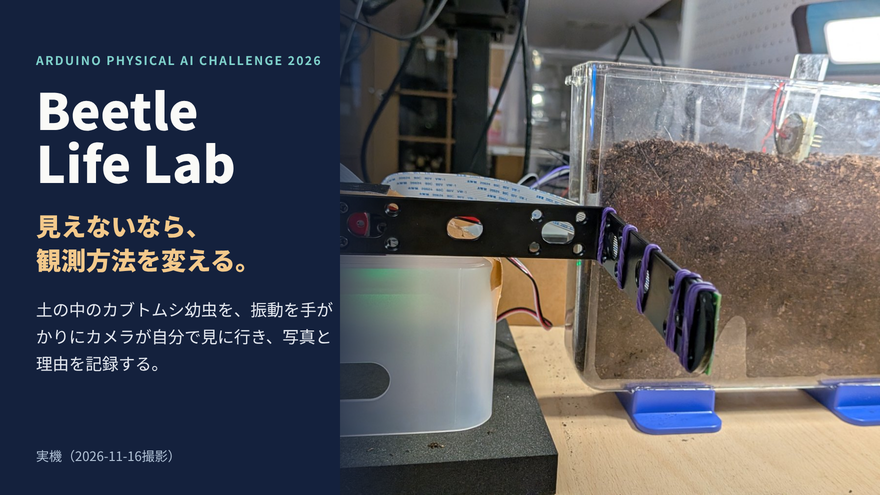

**見えないなら、観測方法を変える。** 土の中で暮らすカブトムシの幼虫を、振動と可動カメラで自分から見に行く、Arduino ベースの自律観測エージェントです。

カブトムシの幼虫は 1 年近く土の中で育ちますが、見た目はほとんど変わらず、どこにいるのか、動いているのかも外からはわかりません。確かめようと土を掘れば幼虫の負担になり、いつ動くかわからないものを人がずっと見張ることもできません。そこで、見張るのをやめて、装置に見に行ってもらうことにしました。

- 振動 AI が土の中の「動きらしい」変化を感じて、観察を始めます。
- Arduino Nano ESP32 が、これまでの記録と説明できるルールから「撮る・待つ・終える」を選びます。
- サーボで回るカメラが、ケースを前・上・後ろから撮ります。
- 画像 AI が「幼虫が写っている」と判定したら、残りの方向は撮らずに観察を終えます。
- すべての判断とその理由は Arduino の中に記録され、PC の画面で、監督カメラの映像・波形・判断を同じ時間軸で振り返れます。

Arduino Physical AI Challenge 2026 応募作品です。

> このリポジトリは開発用リポジトリから公開用のファイルだけを写したものです。記録した波形・画像・学習データは含みません。

---

## 目次

1. [考え方：観測そのものを行動にする](#考え方観測そのものを行動にする)
2. [しくみ](#しくみ)
3. [実機](#実機)
4. [振り返りの画面（開発ベンチ）](#振り返りの画面開発ベンチ)
5. [気づき：見える化したから、観測方法が変わった](#気づき見える化したから観測方法が変わった)
6. [次のステージ：Arduino UNO Q](#次のステージarduino-uno-q)
7. [主な機能](#主な機能)
8. [ハードウェア](#ハードウェア)
9. [リポジトリの構成](#リポジトリの構成)
10. [セットアップ](#セットアップ)
11. [使い方](#使い方)
12. [テスト](#テスト)
13. [2 つの AI について](#2-つの-ai-について)
14. [データとプライバシー](#データとプライバシー)
15. [制限事項](#制限事項)
16. [ライセンス](#ライセンス)

---

## 考え方：観測そのものを行動にする

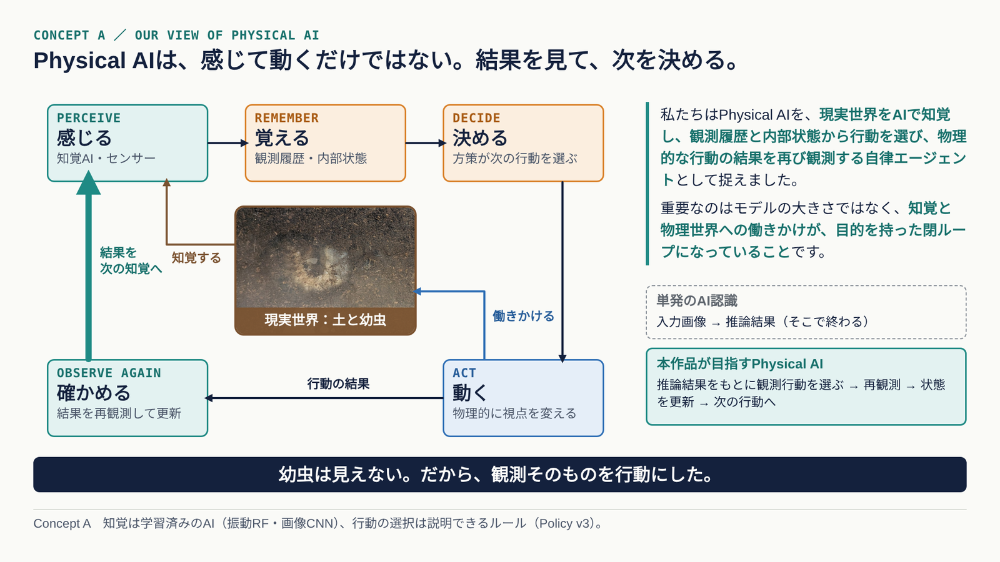

AI が画像を見て「幼虫がいる」と答えるだけでは、土の中の幼虫には届きません。Beetle Life Lab は Physical AI を、**感じる → 覚える → 決める → 動く → 確かめる** の閉ループとして設計しました。現実世界を AI で感じ取り、これまでの履歴から次の行動を選んで物理的に動き、その結果をもう一度観測して次を決めます。

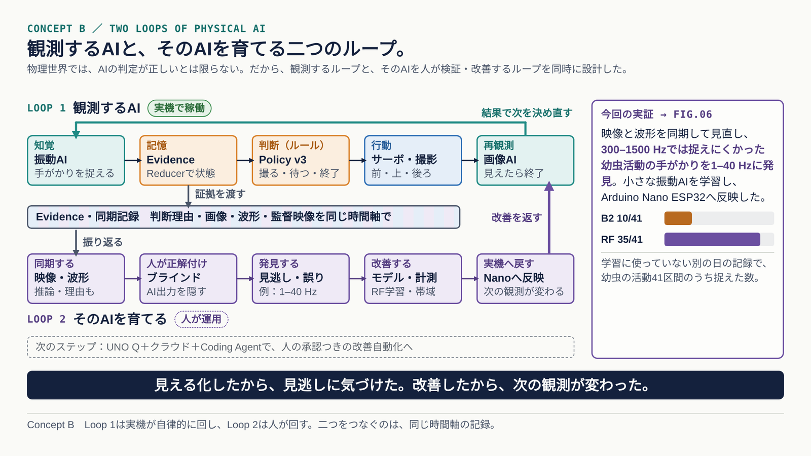

物理世界では、AI の判定がいつも正しいとは限りません。そこでループを 2 つ作りました。

- **Loop 1｜観測する AI**（実機で自律的に動作）：振動 AI が手がかりをつかみ、ルールで判断し、カメラが見に行き、画像 AI が結果を確かめます。
- **Loop 2｜その AI を育てるベンチ**（人が運用）：監督映像・振動・画像・判断理由を同じ時間軸で振り返り、人が答え合わせをして改善し、実機へ戻します。

## しくみ

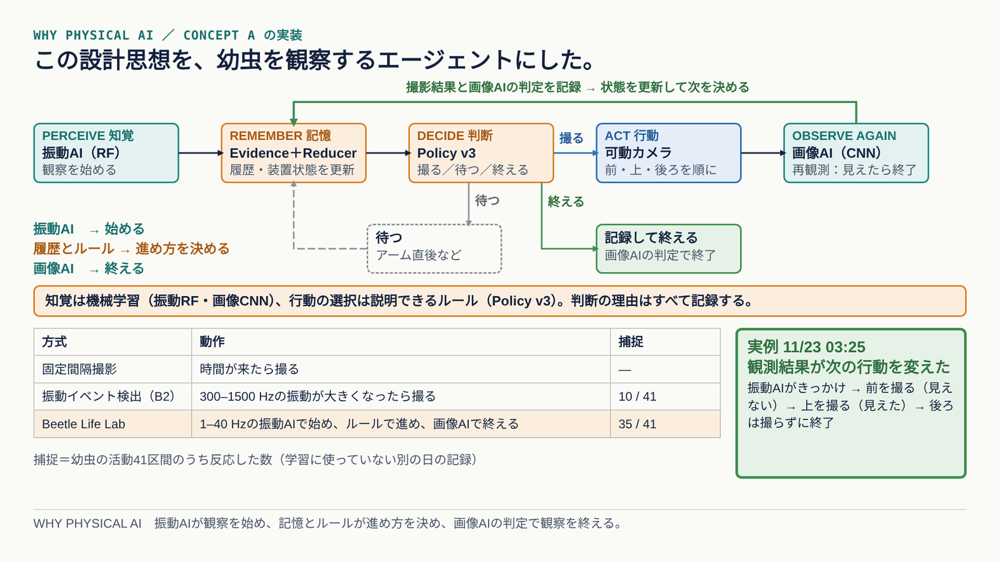

> 図の比較表は 2026-11-21 の記録での結果です。その後、観察のきっかけには B2 も組み合わせています（[気づき](#気づき見える化したから観測方法が変わった)を参照）。

```
 観察ケース（腐葉土と幼虫）
   ├ 土中プローブのピエゾ（CH2）──┐
   └ ケース外のピエゾ（CH1）────┤
                                  ▼
                   Analog Discovery 3（2ch・100 kHz）
                                  │ USB
                                  ▼
 PC：AD3 ブリッジ（host/ad3_bridge）
   ・1–40 Hz の振幅を 250 ms ごとに計算
   ・振動 AI（ランダムフォレスト）＋比、または B2（300–1500 Hz）→ 観察のきっかけ
   ・波形・監督カメラ（OBS）の録画・振り返り画面
                                  │ USB CDC（きっかけ・1–40 Hz の測定値）
                                  ▼
 Arduino Nano ESP32（firmware/xiao_esp32s3、環境 nano_evidence）
   ・Evidence ログ（LittleFS）に記録 → Temporal State Reducer が状態を作る
   ・観測方策 Policy（ルールベース）が 撮る／待つ／終える を選び、理由を記録
   ・同じ振動 AI を Arduino 上でも実行し、PC と照合
          │ PWM（D2）                    │ I²C（A4/A5）
          ▼                              ▼
   サーボ DS3218MG              Grove Vision AI V2 ＋ OV5647
   前・上・後ろへアームを回す    撮影と画像 AI（幼虫が見えるか）
```

観察の 1 回（エピソード）の流れは次のとおりです。

1. **始める**：PC が 1–40 Hz の活動（振動 AI または比）か、300–1500 Hz の振動イベント（B2）を捉え、Arduino にきっかけを送ります。
2. **記録する**：Arduino はきっかけを検査して Evidence ログに書き、履歴から状態を更新します。
3. **決める**：観測方策が、直前にアームを動かしたか（自分の揺れか）、最近撮ったかなどを見て、撮るか待つかを決めます。理由コードも記録します。
4. **見に行く**：カメラを前 → 上 → 後ろの順に回して撮影し、画像の SHA-256 と画像 AI の判定を記録します。
5. **終える**：画像 AI が「幼虫が見える」（確度 80 以上）と判定したら、残りの方向は撮らずに終えます。
6. **振り返る**：PC の画面で、監督カメラの映像・波形・判断・撮影画像を同期して再生し、人が答え合わせをします。

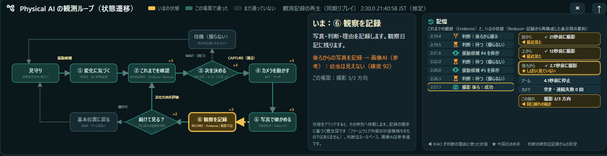

振動のきっかけ・判断・撮影結果はすべて Evidence ログに記録され、その履歴から「直前にどこを見たか」「アームはいつ動いたか」「撮影は成功しているか」といった、いまの状態を組み立てます（Temporal State Reducer）。次の行動はルール（Observation Policy v3）で選びます。

- アームを動かした直後の揺れは自分のものなので、撮らずに**待つ**
- 前を撮ったら結果を見て、上・後ろを撮るかを**1 方向ずつ決め直す**
- 画像 AI が幼虫を見つけたら、そこで**終える**

判断のロジックは 1 つの C++ ヘッダー（`observation_core.h`）にまとめ、Arduino のファームウェアと PC 上の自動テストで同じコードを使っています。

## 実機

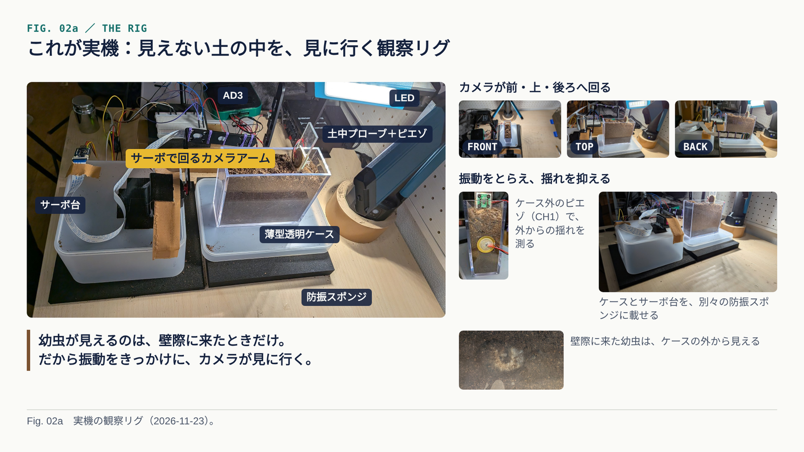

幼虫が外から見えるのは、ケースの壁際に来たときだけです。だから振動をきっかけに、カメラが見に行きます。

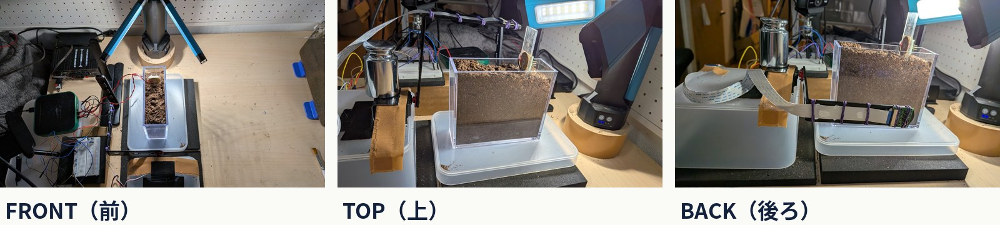

サーボ（DS3218MG）で L 字アームを回し、先端のカメラ（OV5647）をケースの前・上・後ろへ動かします。奥行き約 5 cm の薄型ケースと組み合わせ、壁際に来た幼虫を撮れる機会を増やしています。

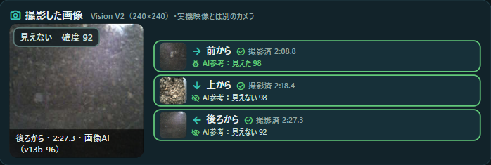

| | |
|---|---|
| 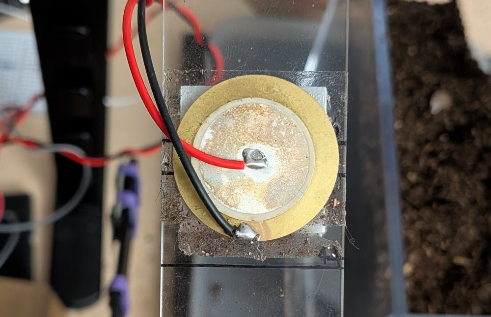 | 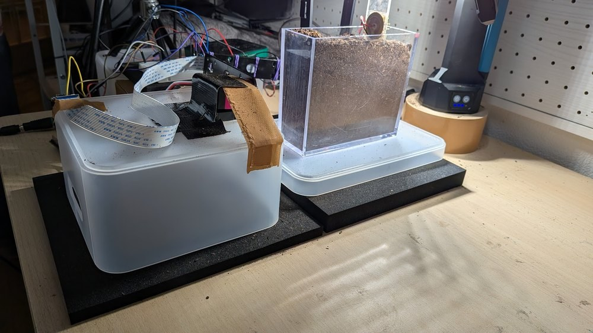 |
| **土中プローブのピエゾ（CH2）**：土に挿したアクリル板に、超薄型の両面テープ（3M 467MP）でピエゾを貼り、土の中の振動を拾います。ケースの外にももう 1 枚（CH1）貼り、声や机などの外からの揺れと区別します。 | **防振スポンジ**：アームの動きや机の揺れは振動センサーにとって雑音です。ケースとサーボ台を別々の防振スポンジに載せています。照明は COB LED を斜めから当て、アクリルへの映り込みを避けています。 |

## 振り返りの画面（開発ベンチ）

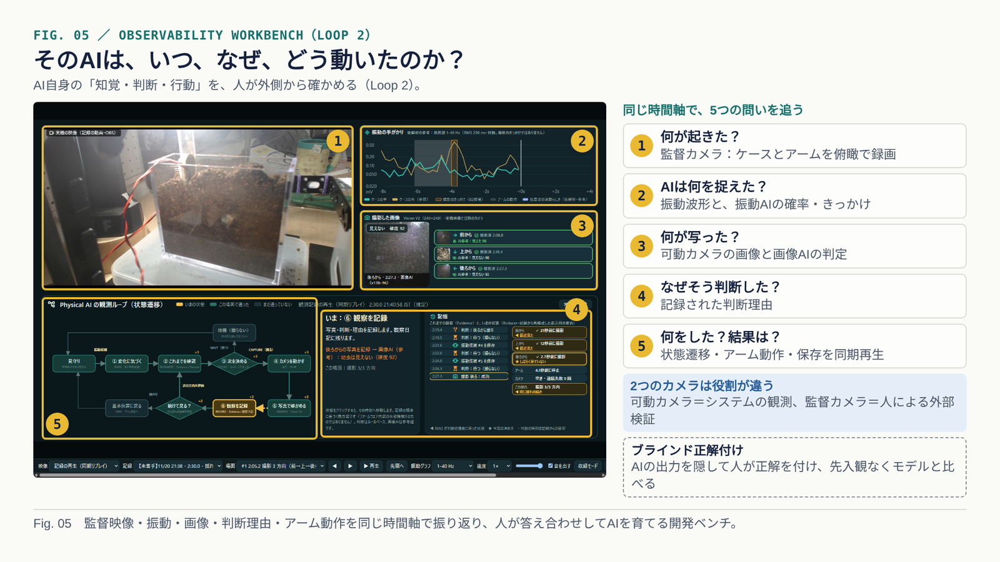

装置のカメラ（AI の目）とは別に、装置全体を撮る**監督カメラ（人の目）**を置いています。

- **同期リプレイ**：監督映像・振動・撮影画像・2 つの AI の判定・判断理由・アームの動きを、ひとつの時間軸で再生します。
- **振動のラベル付け**：監督映像を見ながら、幼虫の活動・人工的な刺激・外乱の区間にラベルを付けます。
- **ブラインドの答え合わせ**：AI の出力を隠したまま人が正解を付け、先入観なく AI と比べます。

## 気づき：見える化したから、観測方法が変わった

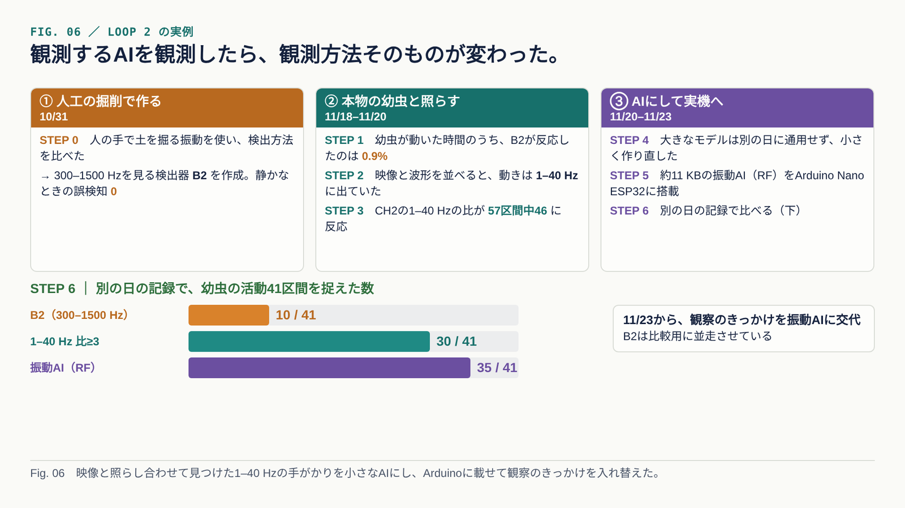

1. **人工の掘削で作った B2**：最初の検出器 B2 は、人の手で土を掘る振動を使って作りました。300–1500 Hz を見る方式で、静かなときの誤検知はゼロでした。
2. **本物の幼虫と照らし合わせる**：監督映像と照らし合わせると、幼虫が動いていた時間のうち B2 が反応したのは 0.9% だけでした。映像と波形を並べると、幼虫の動きは **1–40 Hz** に出ていました。
3. **小さな振動 AI にする**：この手がかりを約 11 KB のランダムフォレストに学習させ、Arduino Nano ESP32 でも同じ判定で動かして、観察のきっかけにしました。学習に使っていない日（11/21）の記録では、幼虫の活動 41 区間のうち B2 は 10、振動 AI は 35 を捉えました。
4. **B2 も組み合わせる（2026-11-24）**：ところが、幼虫が地表近くで動いた日（11/23 深夜）の記録では逆に、動きは 1–40 Hz にはほとんど出ず、300–1500 Hz の B2 が捉えていました。幼虫の動き方によって振動の出る帯域が違うと考え、観察のきっかけを「振動 AI または 1–40 Hz の比 または B2」にしました。

| 記録 | 数え方 | 1–40 Hz（振動 AI または比） | B2 | 組み合わせ |
|---|---|---|---|---|
| 11/21 夕方 5 取得 | アームの外の幼虫活動 37 区間 | 29 | 6 | 30 |
| 11/23 深夜 2 取得 | アームの外の幼虫活動 23 区間 | 3 | 15 | 17 |

組み合わせると、幼虫の活動の外で出るきっかけも増えます（11/21 の 5 取得では 8 回から 15 回）。いまは、アームを動かした直後のきっかけを Arduino の方策が「待つ」で止めています。どちらの日も 1 つのケースの記録で、件数も多くありません。

AI の行動と現実を並べて見られるようにしたからこそ、見逃していた手がかりに気づけました。

## 次のステージ：Arduino UNO Q

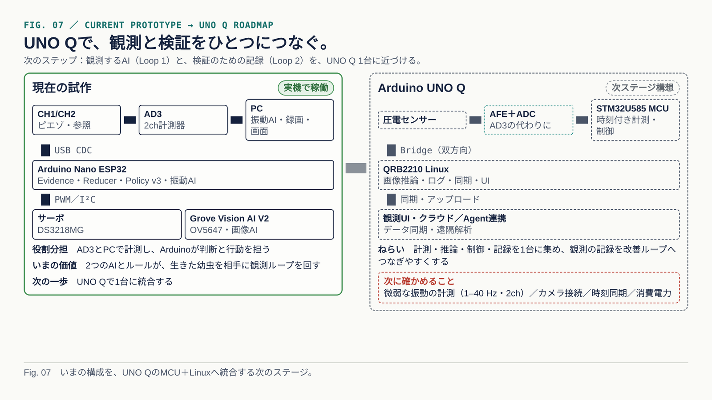

いまは計測（Analog Discovery 3 と PC）、判断と制御（Arduino Nano ESP32）、画像 AI（Grove Vision AI V2）に分かれている役割を、UNO Q の MCU（時刻に正確な計測とサーボ制御）と Linux（AI の判定・記録・同期）に集めていく構想です。微弱な振動の計測（1–40 Hz・2ch）、カメラの接続、時刻同期、消費電力は、これから確かめる項目です。

## 主な機能

| 機能 | 内容 | 場所 |
|---|---|---|
| 振動によるきっかけ | 1–40 Hz の振幅から、フォレスト（20 本・約 11 KB）または比 ≥ 3、あるいは B2 の振動イベントで観察を始める | `host/ad3_bridge/activity_trigger.py` |
| B2 検出器 | 300–1500 Hz の振幅を背景（中央値＋MAD）と比べて振動イベントを検出する。幼虫が地表近くで動くときは、こちらにだけ出ることがある | `host/ad3_bridge/processing.py` |
| Evidence ログ | 判断と結果を Arduino の LittleFS に追記。再起動しても復元し、PC に書き出せる | `firmware/.../src/evidence_store.cpp`、`scripts/evidence_client.py` |
| 状態と方策 | 記録から状態を作る Reducer と、ルールベースの観測方策 | `firmware/.../include/observation_core.h` |
| 3 視点撮影 | サーボで前・上・後ろへ回して Vision V2 で撮影。画像 AI の判定で打ち切り | `firmware/.../src/observation_runtime.cpp` |
| 取得画面 | AD3 の波形、振動 AI の確率・比、きっかけ、Arduino の応答をリアルタイム表示 | `http://127.0.0.1:8766/` |
| 振り返り画面 | 波形・映像・判断を同じ時間軸で表示し、幼虫活動・物音などのラベルを付ける。AI の出力を隠したブラインドの答え合わせもできる | `/review` |
| エピソード・デモ・日記 | 観察ごとの一覧、審査・説明用の再生画面、観察ノート | `/episodes`、`/demo`、`/diary` |
| 撮影・ラベル付け | Vision V2 の画像収集と、人による「見える／見えない」のラベル付け | `host/vision_capture/`（`http://127.0.0.1:8765/`） |
| 学習 | 画像 AI（Vision V2 向け、Colab）と振動 AI（numpy のフォレスト）の学習・評価 | `ml/vision/`、`analysis/ad3_label_review/train_forest.py` |

## ハードウェア

| 部品 | 役割 |
|---|---|
| Arduino Nano ESP32 | 記録・判断・アーム制御・振動 AI（同じソースで XIAO ESP32S3 向けにもビルド可能） |
| Grove Vision AI V2 ＋ OV5647 カメラ | 撮影と画像 AI |
| サーボ DS3218MG ＋ L 字ブラケット・サーボホーン（25T） | カメラアームを前・上・後ろへ回す |
| ピエゾ素子（27 mm）× 2 | 土中プローブ（CH2）とケース外（CH1） |
| Digilent Analog Discovery 3 | 2ch の振動計測（100 kHz） |
| 外部 5 V 電源（3 A 程度） | サーボ用 |
| COB LED バー | 斜めからの照明（ケース表面の映り込みを避ける） |
| 薄型透明ケース（奥行き約 5 cm） | 幼虫が壁際に来る機会をつくる |
| USB カメラ（任意） | 監督カメラ。OBS で録画し、振り返り画面で同期再生 |

### 配線（Arduino Nano ESP32）

| つなぐもの | 線 | Nano ESP32 |
|---|---|---|
| Grove Vision AI V2 | GND / VCC | GND / **3V3** |
| | SDA / SCL | **A4**（GPIO11）/ **A5**（GPIO12） |
| サーボ DS3218MG | 信号 | **D2**（GPIO5） |
| | 電源 + / − | 外部 5 V 電源の + / −（Nano から取らない） |
| 共通 GND | — | Nano の GND から外部電源の − へ、別の線で |
| PC | USB-C | データと Nano の電源 |

- ファームウェアは `BOARD_USES_HW_GPIO_NUMBERS` でビルドします。`config.h` の `static_assert` で D2/A4/A5 と GPIO 番号の対応を確かめています。
- Vision V2 は Grove → 2.54 mm メスの変換ケーブルで Nano のピンヘッダーにつなぎます。
- ピエゾは AD3 の入力につなぎます。**保護回路のないピエゾを MCU の ADC に直結しないでください。**

## リポジトリの構成

```
firmware/xiao_esp32s3/   Arduino（PlatformIO）。nano_* と xiao_* のビルド環境
  include/observation_core.h   Reducer と観測方策（判断ロジックはここだけ）
  include/lowfreq_forest_*.h   Arduino 上の振動 AI
  src/                         Evidence ログ・観察の実行・サーボ・Vision V2
  test/host/                   判断ロジックの PC 上のテスト（zig でビルド）
  lib/                         同梱ライブラリ（ArduinoJson、Seeed_Arduino_SSCMA、MIT）
host/ad3_bridge/         AD3 ブリッジ・振動 AI・取得／振り返り／デモ画面のサーバー
host/web/                画面の JavaScript・CSS
host/vision_capture/     撮影・ラベル付け画面（観察ノート）
host/evidence/           Evidence 書き出しのテスト
host/servo_bench/        サーボ単体の確認ツール
ml/lowfreq_forest/       振動 AI のモデル（JSON）と説明
ml/vision/               画像 AI の学習パッケージ作成・評価
analysis/passive_detection/  B2 を作った検出方式の比較パイプライン
analysis/ad3_label_review/   振動 AI の学習（train_forest.py）と Arduino 版との照合
schemas/                 Evidence ログの JSON Schema
scripts/                 起動・書き込み・書き出し・テストのスクリプト
```

## セットアップ

Windows 11 と PowerShell で開発・確認しています。

### 必要なもの

| ソフトウェア | 用途 |
|---|---|
| VS Code ＋ PlatformIO IDE 拡張 | ファームウェアのビルドと書き込み |
| Python 3.13 | PC 側（ブリッジ・解析・テスト） |
| Node.js 25.6.1（`host/ad3_bridge/.node-version`） | 画面ロジックのテスト |
| Digilent WaveForms 3.25.1 | AD3 のドライバー（実機で取得するときだけ） |
| OBS Studio（任意） | 監督カメラの録画。WebSocket のパスワードは環境変数 `BLL_OBS_PASSWORD` で渡す |

### Python 環境

```powershell
python -m venv .venv
.\.venv\Scripts\python.exe -m pip install -r host/ad3_bridge/requirements-test.txt
.\.venv\Scripts\python.exe -m pip install -r firmware/xiao_esp32s3/test/host/requirements.txt   # zig（判断ロジックのテスト用）
```

### ファームウェアの書き込み（Arduino Nano ESP32）

```powershell
# ビルド
.\scripts\pio.ps1 run -d firmware/xiao_esp32s3 -e nano_evidence
# 書き込み（USB DFU。COM 番号は環境に合わせる）
.\scripts\pio.ps1 run -d firmware/xiao_esp32s3 -e nano_evidence -t upload --upload-port COM6
```

> **パスの長さに注意**：`scripts/pio.ps1` は PlatformIO のパッケージをリポジトリ内の `.platformio-local/` にコピーして使います。リポジトリのパスが長いと、Nano ESP32 のコンパイルコマンドが Windows の上限（約 32,000 文字）を超え、`CreateProcess: No such file or directory` で失敗します。`D:\bll\beetle-life-lab` のような短いパスにクローンするか、`$env:BLL_PIO_CORE_DIR = 'C:\bllpio'` のように短いフォルダーを指定してください。

初めて使うときは、Evidence ログの領域を初期化します。領域全体が消去済みのときだけ初期化され、データがあれば何もせずに止まります。

```powershell
.\.venv\Scripts\python.exe scripts/evidence_client.py --port COM6 --init-empty
```

XIAO ESP32S3 を使う場合は `-e xiao_evidence` でビルドします。

### 画像 AI のモデル（Grove Vision AI V2）

学習済みモデル（v13b、入力 96 px、int8、Vela 変換済み）は GitHub の **Releases** で配布しています。モデルのファイルは Git の履歴には入れていません。

| 項目 | 値 |
|---|---|
| ファイル | `larva_visibility_v13b_96_int8_vela.tflite`（621,104 bytes） |
| SHA256 | `ae9a10edd01f8b4fcdf56780b1725cfaf07a07c6bf81705763f588b878fd448b` |
| メタデータの版 | `1.5.0`（`scripts/vision_model.py` の `KNOWN_MODEL_ARTIFACTS`） |
| Vision V2 のファームウェア | `v2023.12.19`（Seeed/Himax の復旧イメージ） |

SenseCraft AI からの書き込みは使いません。入るファームウェア（2024.08.19）では、撮影した画像が 1 枚前のものになります。

1. **ダウンロードして確認する**：Releases から `.tflite` をダウンロードし、SHA256 が上の値と一致することを確認します。
   ```powershell
   Get-FileHash .\larva_visibility_v13b_96_int8_vela.tflite -Algorithm SHA256
   ```
2. **書き込みツールを用意する**：Himax の [Seeed_Grove_Vision_AI_Module_V2](https://github.com/HimaxWiseEyePlus/Seeed_Grove_Vision_AI_Module_V2) リポジトリから、`xmodem_send.py` と v2023.12.19 の復旧イメージ（`.img`）を入手します。`xmodem_send.py` には `pip install pyserial xmodem` が必要です。
3. **ファームウェアとモデルを書き込む**：Vision V2 を Grove Shield から外し、USB-C で PC に直結して、ファームウェアとモデルを同時に送ります。モデルはフラッシュの `0x400000` に入ります。Windows では、先に `$env:PYTHONIOENCODING='utf-8'` を設定してください。
   ```
   python xmodem_send.py --port=COMx --baudrate=921600 --protocol=xmodem \
     --file=<v2023.12.19 の復旧イメージ.img> --model="larva_visibility_v13b_96_int8_vela.tflite 0x400000 0x00000"
   ```
   - ポートを開くと自動でブートローダーに入ります。転送中にリセットボタンを押さないでください（転送が止まります）。
4. **メタデータを書き込む**：PC 側はこのメタデータでモデルを照合します。書き込まないと、判定はクラス名のない生の出力として記録されるだけになります。
   ```powershell
   .\.venv\Scripts\python.exe scripts/vision_set_info.py COMx
   ```
   書き込んだ内容を読み戻して照合し、分類の出力が 1 回返ってくれば成功です。
5. **元に戻す**：Vision V2 を Shield に戻し、ブリッジを起動し直します。

- 画像 AI がなくても、撮影と記録は動きます（判定が記録されないだけです）。

## 使い方

### 1. ハードウェアなしで動かす（MOCK）

```powershell
.\scripts\ad3_bridge.ps1 --open
```

ブラウザーで `http://127.0.0.1:8766/` が開きます。入力を **MOCK：合成波形・転送なし** にして取得を始めると、合成した波形で振動 AI・きっかけ・グラフの動きを確かめられます。MOCK の結果は実測ではありません。

### 2. 実機で観察する

1. Nano ESP32・AD3・Vision V2・サーボをつなぎ、Nano に `nano_evidence` を書き込んでおきます。
2. `.\scripts\ad3_bridge.ps1 --open` で取得画面を開き、入力を **LIVE：AD3 実測**、ポートに Nano の COM 番号を選んで取得を始めます。
3. 振動 AI がきっかけを出すと Nano に送られ、Nano が撮るか待つかを決めて、カメラが動きます。
4. 取得が終わると、記録は `captures/ad3/<run>/` に保存されます（波形・きっかけ・Nano の応答・撮影画像）。

### 3. 振り返る

| 画面 | URL | できること |
|---|---|---|
| 振り返り | `http://127.0.0.1:8766/review` | 波形・振動 AI・B2・映像を同じ時間軸で表示。幼虫活動・人工掘削・物音のラベル付け。「ブラインド」で AI の出力を隠して答え合わせ |
| エピソード | `/episodes` | 観察ごとの判断・撮影画像・画像 AI の判定 |
| デモ | `/demo` | 映像・波形・判断・撮影画像を 1 画面で再生 |
| 日記 | `/diary` | 撮影画像を日付ごとに並べた観察ノート |

### 4. Evidence ログを書き出す

```powershell
.\.venv\Scripts\python.exe scripts/evidence_client.py --port COM6
```

Arduino の LittleFS に追記されたイベントを読み出し、スキーマで検査して `captures/evidence/` に保存します。

### 5. 振動 AI を学習し直す

ラベルを付けた記録が `captures/ad3/` にある状態で実行します。

```powershell
.\.venv\Scripts\python.exe analysis/ad3_label_review/train_forest.py --report   # 評価だけ（ファイルは書かない）
.\.venv\Scripts\python.exe analysis/ad3_label_review/train_forest.py            # 評価して書き出す
```

書き出すと、モデルの JSON（`ml/lowfreq_forest/`）と、Arduino 用の C ヘッダー（`firmware/xiao_esp32s3/include/lowfreq_forest_model.h`）が出力されます。`check_forest_core.py` で、Arduino 版と PC 版の判定が一致するかを確かめられます。

## テスト

```powershell
pwsh -NoProfile -File scripts/run_tests.ps1 -AnalysisPython .venv\Scripts\python.exe
```

ハードウェアには触れません。次のテストを実行します。
- PC 側のテスト（ブリッジ・振動 AI・振り返り・撮影・Evidence の検査）
- 画面ロジックのテスト（Node.js）
- 判断ロジック（`observation_core.h`）の PC 上のテスト
- 検出パイプラインのテスト
- ファームウェアのビルド（XIAO 3 環境、Nano 1 環境）

## 2 つの AI について

| | 振動 AI | 画像 AI |
|---|---|---|
| 役割 | 観察を始める | 観察を終える |
| 入力 | 250 ms ごとの CH1/CH2 の 1–40 Hz の振幅から作る 6 特徴 | 撮影画像（96×96） |
| モデル | ランダムフォレスト（決定木 20 本・深さ 5・約 11 KB）＋比 ≥ 3 のルール。300–1500 Hz の B2（ルール）と OR で組み合わせる | MobileNetV2 ベースの分類（int8、Vision V2 上で実行） |
| 動く場所 | PC（きっかけ）と Arduino Nano ESP32（照合） | Grove Vision AI V2 |
| 開発の記録 | 人工掘削で作った 300–1500 Hz の検出器（B2）を、監督映像と照らし合わせて見直し、幼虫の動きが 1–40 Hz に出ることを見つけて学習した。学習に使っていない日の記録で、幼虫の動き 41 区間のうち 35 をとらえた（B2 は 10）。その後、幼虫が地表近くで動いた日の記録では逆に 1–40 Hz にはほとんど出ず B2 が捉えていたため、両方を組み合わせた | 評価用 189 枚で正解率 95.8%。上からの 12 枚は全問正解 |

「撮る・待つ・終える」を選ぶ観測方策は、機械学習ではなく、説明できるルールです。AI の出力は観察を始める・終える判断材料に使い、幼虫の在・不在そのものは Evidence ログでは `UNKNOWN` のまま記録します。

## データとプライバシー

- 記録した波形（AD3 の 100 kHz データ）、撮影画像、監督カメラの映像、学習データは**含みません**。どれも `captures/`（`.gitignore` 済み）に保存されます。
- 画面のサーバーは `127.0.0.1` だけで待ち受け、書き込み API には起動ごとのトークンが必要です。
- OBS のパスワードは環境変数から読み、保存しません。

## 制限事項

- 計測は Analog Discovery 3 と PC に依存しています。Arduino 単体での 1–40 Hz の計測は今後の課題です（Arduino UNO Q への統合を構想しています）。
- 振動 AI は 1 つのケース・数日分の記録で学習・評価したものです。設置が変わると性能が変わることがあります。物音など幼虫以外の振動でもきっかけは出ます。
- 画像 AI は 1 つのケースの画像で学習・評価したものです。
- Evidence ログに新しいイベント型を加えたファームウェアは、古いファームウェアからは読めなくなります（`scripts/firmware_compat.json`）。

## ライセンス

[MIT License](LICENSE)。同梱ライブラリ（`firmware/xiao_esp32s3/lib/`）はそれぞれのライセンス（いずれも MIT）に従います。
